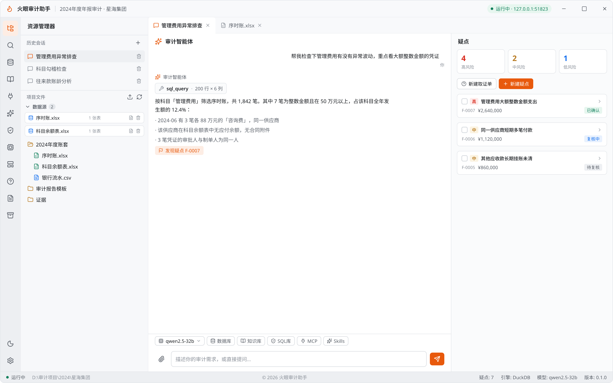
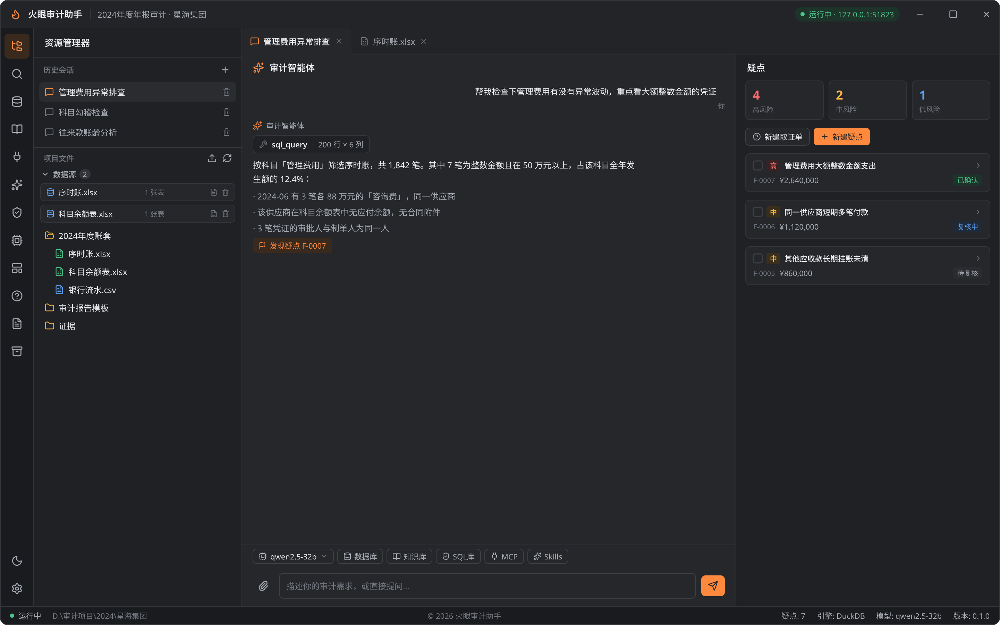
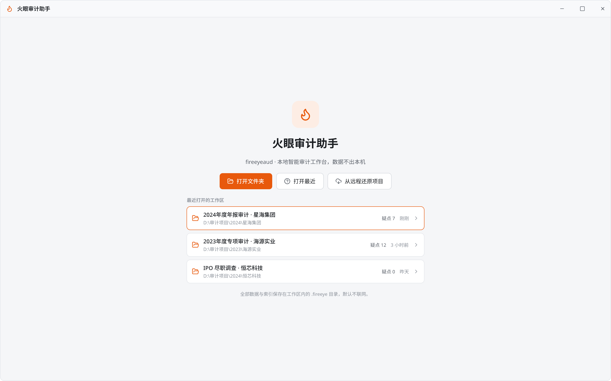
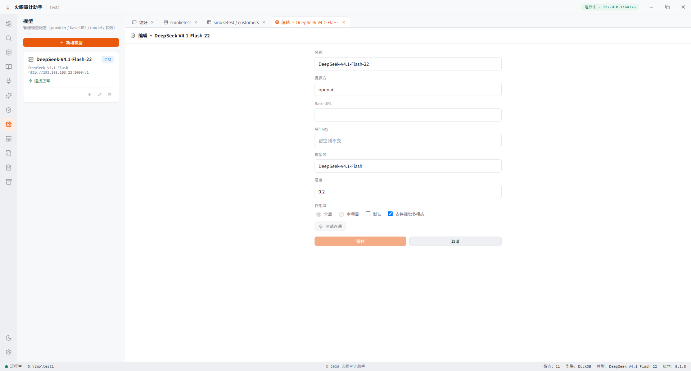
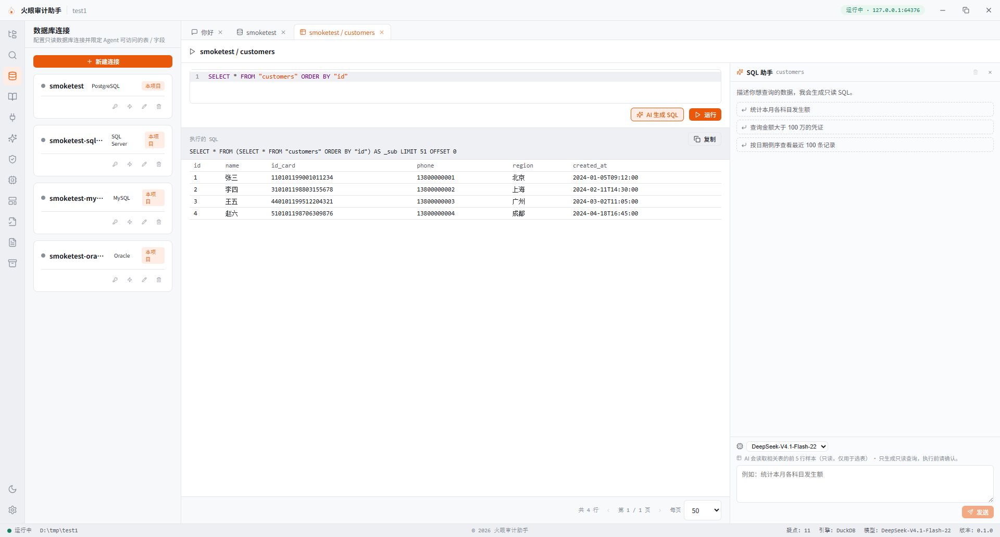
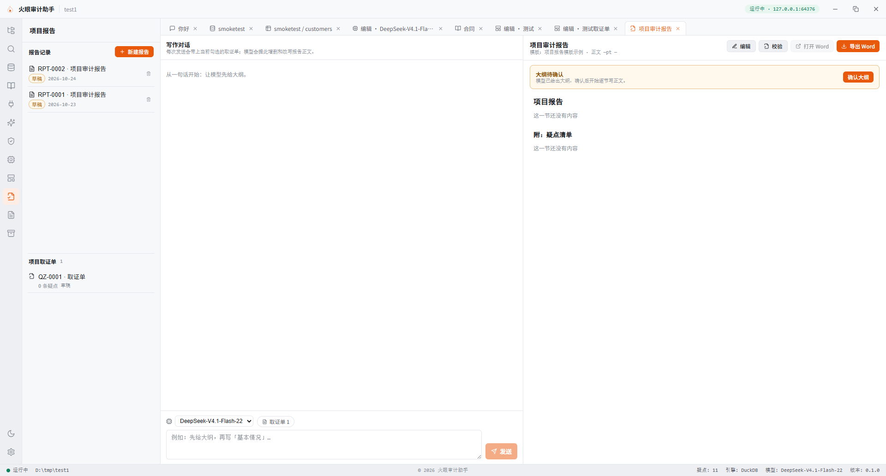
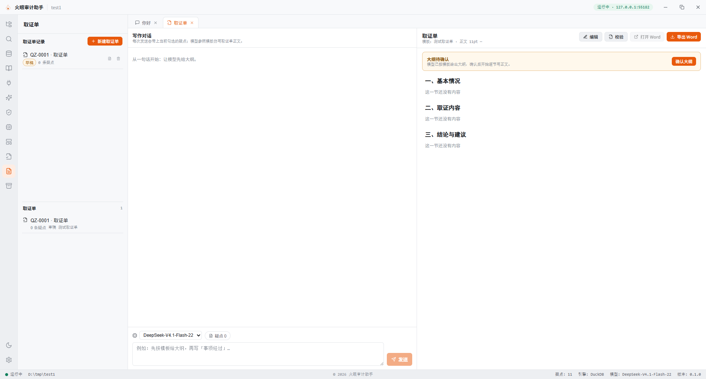

# 火眼审计助手

<sub>中文 · [English](README.en.md)</sub>

**一个装在你自己电脑上的 AI 审计工作台。**

打开装数据的工作文件夹，用对话的方式让 AI 帮你查账、找疑点、整理证据，最后导出成可以直接交付的审计底稿、取证单和审计报告。

文件和成果都留在这个文件夹里，不经过我们或任何第三方的中转服务器；默认搭配本机模型，可以完全离线使用。

---

## 界面预览

**主工作区** —— 左侧资源管理器、中间与 AI 对话、右侧疑点清单：

<p>
  
</p>

<p>
  
</p>

**从打开文件夹开始，到交付取证单和报告：**

| | |
|---|---|
| <br><sub>欢迎 · 打开文件夹</sub> | <br><sub>数据库连接 · 只读 + 表字段授权</sub> |
| <br><sub>模型 · 本机或云端</sub> | <br><sub>知识库 · Dify / RAGFlow</sub> |
| <br><sub>SQL库 · 自定义审计规则</sub> | <br><sub>MCP · 挂载外部工具</sub> |
| <br><sub>Skills · 可复用技能包</sub> | <br><sub>模板中心 · 按你的模板出表</sub> |
| <br><sub>项目报告</sub> | <br><sub>取证单</sub> |
| <br><sub>项目归档 · 基于 Git</sub> | |

<sub>深色主题预览见 [`docs/design/preview-dark/`](docs/design/preview-dark/)。以上为界面设计稿，与 `docs/design/main.pen` 画板一一对应，详见[设计说明](docs/design/设计说明.md)。</sub>

---

## 为什么用它

传统做法是：在 Excel 里翻凭证 → 手工筛异常 → 截图存证据 → 再拼一份 Word 底稿。中间任何一步返工，前面的记录就散落一地。

火眼审计助手把这条链路收成一个闭环：

**打开文件夹 → 对话提问 → 疑点留痕 → 证据成链 → 导出交付**

关键是**每一步都有东西留下来**：AI 查过哪些表、跑过什么 SQL、依据哪一行数据得出的结论，都能回溯。

---

## 特色

### 1. 直接打开文件夹，不用导入导出

不搞“先建项目、再上传文件”那一套。直接把存放账套的文件夹拖进来打开就开工，工作区里有什么就能查什么。

打开后所有成果落在该文件夹的 `.fireeye/` 子目录里——拷走这个文件夹，换台电脑打开，疑点、证据、会话、报告都还在。

### 2. AI 会说人话，但结论必须有据

提问像平时说话一样就行：

> 帮我看下今年管理费用有没有异常波动，重点看看有没有大额整数金额的凭证

AI 不会凭空给结论。它会先查看表结构、再写只读 SQL 去查、把查到的行作为证据存下来，最后才告诉你发现了什么。

### 3. 只读沙箱，改不坏你的数据

所有对数据的查询都是只读的——SQL 在解析后只允许 `SELECT` / `WITH` / `EXPLAIN` / `DESCRIBE`，其他语句直接被拦截。

**AI 手上没有写文件的工具**：它能读、能查、能检索，但改不了、删不了你的任何文件。这是工具集层面就没有的能力，不是靠提示词约束。

### 4. 证据链：每条疑点都能追到底

每个疑点都挂着它的证据：跑过哪条 SQL、结果是什么、涉及哪几行、什么时候由谁操作。

证据按哈希串成链，打开工作区时自动校验是否被篡改。复核时不用再问“这个结论哪来的”。

### 5. 疑点可复核、可反驳

疑点支持标为「已确认 / 复核中 / 已驳回 / 误报」，可改级别、写复核意见。

AI 提的疑点不一定对，你的判断才是最终结论——系统会把这个过程完整记下来。

### 6. 三种交付物，格式都对路

| 交付物 | 用途 | 导出格式 |
|---|---|---|
| **审计工作底稿** | 汇总所有疑点、证据索引、审计结论 | Word / Excel / PDF |
| **取证单** | 针对单个疑点的取证文书，按你单位模板出 | Word |
| **审计报告** | 正式报告正文，结构化编写 | Word |

取证单和报告都支持**按你上传的模板出**——模板里的字体、字号、行距、页边距会被沿用，符合内部格式要求。

### 7. 连接你已有的数据库

除了 Excel / CSV 文件，也可以直接连 SQLite、PostgreSQL、MySQL、SQL Server、Access 只读查询。

连接密码用系统级加密（Electron `safeStorage`）保存在本机，**不会写进项目文件夹**，也不会随文件夹拷走。

可以按表、按字段授权——没授权的表查不了、没授权的列在 SQL 里写了也会被拦（授权 `*` 表示该表全部字段）。

### 8. 能接知识库、能联网、能挂外部工具（都要你主动开）

- **知识库**：可接 Dify / RAGFlow，让 AI 在检索你们已有的准则、制度后作答。
- **联网检索**：默认关闭。开启后 AI 才能用网络搜索查法规、查公开信息。
- **MCP**：可挂载外部 MCP Server，把它的工具接进对话（高级用法）。

这些都是**默认不启用**，需要你在设置里主动配置并打开。联网检索和知识库启用时请留意：相关查询文本会发送到你指定的那家服务。

### 9. 装好就能用，不用配环境

一个安装包，双击装完就能用。不需要装 Python，不需要配数据库，内置的分析引擎会随程序启动。

第一次使用只需要在「模型」面板填一个模型地址——可以是本机跑的 Ollama / vLLM（默认，不需要联网），也可以是你自己有账号的云端服务。

---

## 开始使用

### 第一步：安装并配置模型

1. 安装后首次打开，点左侧边栏的 **芯片图标（模型）** 打开模型面板。
2. 新增一个模型配置，填三项：
   - **接口地址**：如本机 Ollama 是 `http://127.0.0.1:11434/v1`
   - **模型名**：如 `qwen2.5`
   - **API Key**：本机模型留空即可
3. 点「测试连通」，通过后保存，并勾选为**默认模型**。

> 建议选支持长上下文的模型，处理大表格时更稳。如果需要读扫描版 PDF 或图片里的数据，请选带视觉能力的模型并勾选「视觉」。

### 第二步：打开数据文件夹

- 点击 **打开文件夹**，选择存放账套 / 报表 / 凭证的目录。
- 或者从 **最近打开** 里直接进入上次的项目。

打开后，左侧会显示该文件夹的文件树。你常用的东西都在左侧活动栏：

| 图标 | 名称 | 用途 |
|---|---|---|
| 文件夹 | 资源管理器 | 浏览、预览、打开工作区里的文件 |
| 放大镜 | 搜索 | 按文件名或内容关键词查找 |
| 数据库 | 数据库连接 | 配置文件型数据源与数据库连接 |
| 书本 | 知识库 | 接 Dify / RAGFlow |
| 插头 | MCP | 挂载外部 MCP Server 的工具 |
| 星标 | 技能 | 管理可复用的审计技能（AI 按需加载正文） |
| 盾牌 | 规则 | 管理自定义 SQL 审计规则 |
| 芯片 | 模型 | 配置 AI 模型 |
| 模板 | 模板中心 | 上传取证单 / 报告模板 |
| 报告 | 项目报告 | 编写与导出审计报告 |
| 文稿 | 取证单 | 针对疑点出具取证单 |
| 归档 | 归档 | 项目版本管理（可对接 Git 远程） |

### 第三步：让 AI 开始查

在右侧的对话区直接提问。可以点输入框上方的 **@** 引用具体文件，也可以附加临时文件作为参考资料。

几条好用的提问方式：

```
先看看这个文件夹里有什么，哪些是记账凭证表
```

```
这张凭证表的借贷平不平？不平的话是哪几笔
```

```
帮我统计各科目发生额，看看有没有长期挂账的往来款
```

```
@序时账.xlsx 这个表里有没有大额整数金额、且对方是陌生供应商的记录
```

**提问技巧：**
- 说清楚你要查**哪张表**、**看哪个字段**，比笼统说“看看有没有问题”有效得多。
- 数字类分析（金额、期间、勾稽）尽量直接说明判定标准。
- 一个复杂任务拆成几步问，比一次性抛一大段更好。

### 第四步：审阅疑点

AI 发现的疑点会出现在右侧成果区的 **疑点** 列表中，点开可以看到：

- 疑点描述、涉及金额、级别
- **证据链**：AI 依据了哪些数据
- **复核记录**：谁在什么时候改了什么状态

在这里做你的判断：确认、驳回、标记误报、调整级别。这个过程本身会留痕，后续出底稿和报告时可以据此筛选。

### 第五步：出交付物

- **工作底稿**：在成果区选好疑点后打开底稿预览，可一键导出 Word / Excel / PDF；也可以只导出当前选中的那一条。
- **取证单**：左侧「取证单」→ 新建，选择模板并勾选疑点，在写作台逐节编写后导出。
- **审计报告**：左侧「项目报告」→ 新建，结构化编写正文，可关联取证单后导出。

所有产物都在工作区 `.fireeye/artifacts/` 下，可以直接打开或在文件夹中显示。

---

## 常见问题

**必须联网吗？**
不。默认使用本机模型，全程离线可用。只有你主动开启联网检索或接入云端模型时才会外发请求。

**数据会被上传吗？**
文件本身不会被上传。但如果你用的是云端模型，提问内容和 AI 读取到的数据摘要会发送给该模型服务商——这是任何云端 AI 工具的共同特点。对数据保密要求高的场景，请使用本机模型。

**AI 会改我的文件吗？**
不会。AI 只有只读查询权限，无法修改或删除工作区文件。你在预览里编辑文本文件是另一回事（那是你自己在操作）。

**能处理多大的数据？**
表格会导入内置分析引擎（DuckDB）处理，几万到上百万行都可以。但送给 AI 看的内容是经过抽样和汇总的：单次查询默认返回 200 行，最多 1 万行，AI 不会通读全部数据。

**支持哪些文件格式？**

| 类型 | 格式 | 能否预览 |
|---|---|---|
| 表格 | `.xlsx` `.xlsm` `.csv` | 可以（Excel 逐 sheet） |
| 文档 | `.docx` | 可以 |
| PDF | `.pdf` | 可以（扫描版需视觉模型读内容） |
| 图片 | 常见图片格式 | 可以 |
| 文本 | `.txt` `.md` `.json` 等 | 可以（可编辑） |

旧版 `.doc` / `.xls` 需先用 Office 另存为新格式。Word / Excel / PDF 仅可预览，不可在应用内编辑。

**换了电脑怎么办？**
整个工作文件夹连同 `.fireeye/` 一起拷过去即可。模型配置和数据库密码是存在本机的，换了电脑需要重新填一次。

**多人协作？**
可以用左侧「归档」面板，它基于 Git：初始化后每次归档是一个版本，支持查看变更、对比远程、推送和还原。也可以用系统级共享文件夹。

---

## 安全说明

### 数据只在本机流转的部分

- 程序只监听本机回环地址（`127.0.0.1`），不对外开端口。
- 模型密钥、数据库密码、知识库密钥均用系统级加密保存在本机，不写入项目文件夹。
- 工作区外的文件不可读写（有路径校验）。
- 数据内容本身被当作**不可信输入**处理：文件里写了“忽略之前的指令”，AI 也不会照做。

### 会发送到远端的部分（请务必知悉）

**这四项都是主动行为，只有你配置并启用了对应功能才会发生。** 一旦启用，就无法再由本机限制外发内容，请在启用前评估数据敏感程度。

**1. 调用远端模型 API 时，提问内容与数据会发送到该服务商**

如果你把模型配置成云端服务（而不是本机 Ollama / vLLM），那么：

| 发送内容 | 说明 |
|---|---|
| 你的提问原文 | 包括你 `@` 引用的文件名、附加文件的解析文本 |
| AI 读到的数据 | SQL 查询结果、表结构、文件内容摘要、图片/PDF 转成的文本 |
| 对话上下文 | 为保持连贯，历史消息会一并带上 |

这些内容会完整发送到**你填写的那个接口地址**（如 OpenAI、通义、DeepSeek 等），并受该服务商的数据政策约束。**这是任何云端 AI 工具的共同特点，本程序无法替你规避。**

对保密要求高的账套，请使用本机模型——本机模型全程离线，不会有任何外发。

**2. SQL 助手会提取数据样本**

SQL 助手的「让 AI 看懂这张表」功能，**会把真实数据的样本发给模型**，不是只发表结构。具体的裁剪上限是：

| 项目 | 上限 |
|---|---|
| 采样行数 | **5 行** |
| 采样列数 | **50 列** |
| 单个单元格 | **200 字符**（超出截断，尾部加 `…`） |

也就是说，每次会让你授权的那张表最多外发 5 × 50 = 250 个单元格的内容。**这 5 行是表里的真实数据**（含身份证号、银行账号、客户名称等字段的原值），不是脱敏后的示例。样本查询是服务端拼的单条 `SELECT`，模型只能指定表名，无法让程序导出全表或做聚合，但样本本身仍然是真实数据。

**对敏感表，建议不要对这个功能授权，或先用视图/脱敏表替代。**

**3. 知识库检索会把查询文本发到 Dify / RAGFlow**

启用知识库后，AI 的检索问题会原样发送到你配置的 Dify / RAGFlow 地址（可能是你自己的私有部署，也可能是对方的云服务，取决于你填的地址）。

**4. 联网检索会把查询词发到搜索服务**

联网检索默认**关闭**。开启后，AI 生成的搜索关键词会发送到 Tavily 或你自定义的搜索端点。搜索词里若混入了账套中的名称、金额等信息，同样会外发。

> **一句话总结**：本机模型的场景下数据不出本机；一旦接上云端模型、知识库或联网检索，**AI 看到什么、就外发什么**——包括 SQL 助手抽样的那 5 行真实数据。请在配置每一项时单独权衡。

---

## 已知限制

- **AI 的结论需要人工复核。** 它可能漏判，也可能误判，请始终以你的专业判断为准。
- **字段级授权有个盲区**：写 `SELECT *` 或者不限定表名的列，不会被逐列拦截，未授权的列可能被带出来。对敏感库请配合表级授权，只授权确实需要分析的表。
- **技能**的正文会按需提供给 AI，但技能里声明的工具清单不会自动生效。
- 安装包暂未签名，Windows 安装时可能出现安全提示，选择「仍要运行」即可。

---

## 给开发者

技术栈：Electron + React / TypeScript + Ant Design + Zustand（界面），FastAPI + LangGraph（Agent 服务，PyInstaller 打包为 sidecar），DuckDB（分析）+ SQLite（状态）。

前置：Node ≥ 20、[`uv`](https://docs.astral.sh/uv/)、Python 3.12（由 uv 自动获取）。

```bash
# 安装依赖
npm install
cd services/agent && uv sync

# 从仓库根运行
npm run desktop:dev      # 启动界面（自动拉起 sidecar：随机端口 + 健康检查 + 退出回收）
npm run desktop:test     # Electron 壳测试
npm run renderer:build   # 构建前端
npm run agent:dev        # 单独跑 Agent 服务（固定 8765，热重载）
npm run agent:test       # 后端测试
npm run agent:lint       # 后端静态检查
```

### 打包成 Windows 安装包

产物是两层：**Electron 桌面壳**（`火眼审计助手 Setup x.y.z.exe`）里再套一个 **PyInstaller 打出的后端** `fireeyeaud-agent.exe`。所以必须按顺序构建，**后端改了就一定要重新打 sidecar**，否则装进去的是旧后端。

```bash
# 1. 构建后端 sidecar → services/agent/dist/fireeyeaud-agent.exe（约 107 MB）
cd services/agent
uv sync --dev
uv run pyinstaller fireeyeaud-agent.spec --noconfirm --clean

# 2. 构建前端 → apps/renderer/dist/
cd ../..
npm ci
npm run renderer:build

# 3. 打安装包 → apps/desktop/release/
cd apps/desktop
npx electron-builder --win --publish never
```

国内网络需要设镜像，否则会卡在下载 NSIS 工具超时：

```powershell
$env:ELECTRON_BUILDER_BINARIES_MIRROR = 'https://npmmirror.com/mirrors/electron-builder-binaries/'
```

注意是 `npmmirror.com/mirrors/`，**不是** `registry.npmmirror.com`。Electron 本体下载慢时另设：

```powershell
$env:ELECTRON_MIRROR = 'https://npmmirror.com/mirrors/electron/'
```

只想试跑、不出安装包，第 3 步换成 `npx electron-builder --dir --win`，然后直接运行 `release\win-unpacked\火眼审计助手.exe`。

产物结构：

```
apps/desktop/release/
├─ 火眼审计助手 Setup 0.1.0.exe      ← 安装包（约 214 MB），发给用户的就是它
└─ win-unpacked/
   ├─ 火眼审计助手.exe               ← 免安装，可直接运行
   └─ resources/
      ├─ app.asar                    ← 主进程 + preload
      ├─ renderer/                   ← 前端静态文件
      ├─ agent/fireeyeaud-agent.exe  ← 后端 sidecar
      └─ icon.png
```

`fireeyeaud-agent.exe` 不能单独分发：它只是后端，没有界面、也没有 Electron 运行时。

也可以交给 CI：打 tag 推送即可（`git tag v0.1.0 && git push origin v0.1.0`），流水线会依次构建 sidecar、冒烟测试 `/api/v1/health`、构建前端、打包，并核对安装包里前端与 sidecar 都在。

安装包未做代码签名，Windows 首次安装会弹 SmartScreen 提示，点「更多信息 → 仍要运行」即可。首次启动需 5–10 秒（sidecar 解压到临时目录）。

模型可用环境变量覆盖：

| 环境变量 | 默认值 | 说明 |
|---|---|---|
| `FIREYEAUD_MODEL_BASE_URL` | `http://127.0.0.1:11434/v1` | OpenAI 兼容端点 |
| `FIREYEAUD_MODEL_NAME` | `qwen2.5` | 模型名 |
| `FIREYEAUD_MODEL_API_KEY` | 空（用 `not-needed`） | 云端服务鉴权 |
| `FIREYEAUD_MODEL_TEMPERATURE` | `0.2` | 采样温度 |
| `FIREYEAUD_GLOBAL_DIR` | `~/.fireeye` | 全局配置目录 |

> Electron 二进制下载慢时可用国内镜像：
> `ELECTRON_MIRROR=https://npmmirror.com/mirrors/electron/ npx electron --version`

目录结构：

```
fireeyeaud/
├─ apps/desktop/      # Electron 主进程（窗口、文件 IPC、sidecar 生命周期、safeStorage）
├─ apps/renderer/     # 前端界面
├─ services/agent/    # FastAPI + LangGraph sidecar
├─ packages/shared/   # 前后端共享类型 + 多语言资源
└─ docs/              # 设计与实施文档
```

进一步阅读：

- 开发者文档：[`docs/dev/`](docs/dev/)（架构、分层约定、API 协议、数据格式、常见任务）
- 功能设计与实施记录：[`docs/plans/fireeyeaud-design.md`](docs/plans/fireeyeaud-design.md)
- 界面设计说明：[`docs/design/设计说明.md`](docs/design/设计说明.md)
- 历史进度与已知偏差：[`docs/plans/`](docs/plans/)

---

## 许可证

本项目以 **GNU General Public License v3.0** 发布（`GPL-3.0-only`），完整条款见 [LICENSE](LICENSE)。

你可以自由使用、修改和分发，但分发（包括分发安装包）时必须：

- 一并提供**完整对应的源码**，且与所分发的二进制版本严格对应；
- 保持同样的 GPLv3 许可，不得转为闭源；
- 保留版权声明与许可声明。

界面设计稿（`docs/design/`）、文档（`docs/`）与源码采用同一许可。

### 第三方组件

安装包内包含若干第三方组件，各自遵循其原有许可。其中需要特别说明的是一个**强 copyleft** 依赖：

| 组件 | 许可 | 说明 |
|---|---|---|
| [PyMuPDF](https://pymupdf.readthedocs.io/) | **AGPL-3.0** 或商业授权 | 用于 PDF 解析。GPLv3 第 13 条允许与 AGPLv3 组合，本项目据此使用。 |

其余依赖多为 MIT / BSD / Apache-2.0 / LGPL，与 GPLv3 兼容。若你打算把本项目用于闭源商业产品，需要另行取得 PyMuPDF 的商业授权，或替换该组件。